<p align="center">
  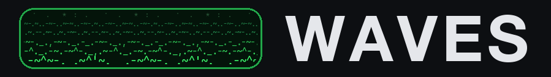
</p>

<p align="center">
  <strong>A native desktop app for saving music from your own TIDAL account for offline listening.</strong>
  <br>
  Search-first, art-forward, and built for people who'd rather click than type.
</p>

<!-- The badges and the link row each live on ONE source line on purpose:
     GitHub joins split lines into a row, but other renderers (the mirror
     frontends among them) treat each source line as its own line and stack
     them vertically. -->
<p align="center">
  <a href="https://github.com/iamprivacy/Waves/releases/latest"></a> <a href="#install"></a> <a href="LICENSE"></a>
</p>

<p align="center">
  <a href="#features"><strong>Features</strong></a> · <a href="#install"><strong>Install</strong></a> · <a href="#privacy"><strong>Privacy</strong></a> · <a href="#faq"><strong>FAQ</strong></a> · <a href="#acknowledgments"><strong>Acknowledgments</strong></a> · <a href="https://getwaves.dev"><strong>getwaves.dev</strong></a>
</p>

<p align="center">
  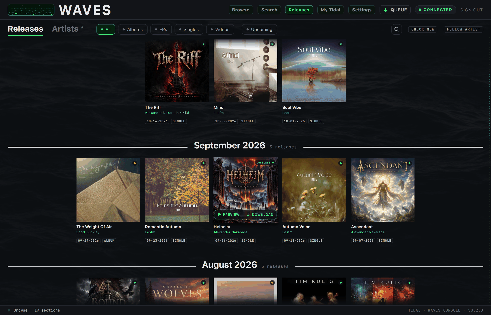
  <br>
  <sub>Every new release from the artists you follow, in one feed. A dot in the corner of each cover gives its quality and spells it out when you point at it.</sub>
</p>

Waves is a desktop app for macOS, Windows and Linux. Search all of TIDAL from one bar, listen before you choose, and keep a track, an album, a playlist or an artist's whole discography on your own drive, tagged and filed the way your music player expects. Follow the artists you love, and everything new they put out lands in one feed.

> [!NOTE]
> A paid TIDAL plan is required. Waves saves from **your own** account, for your personal, non-commercial use, and can only save what your account can play, up to HiRes Lossless / TIDAL MAX (24-bit, 192 kHz) and Dolby Atmos where available.

<table>
  <tr>
    <td align="center" width="25%">🖥️<br><strong>Truly native</strong><br><sub>macOS, Windows and Linux, on Intel/AMD and ARM. One real window: no web view, no Electron.</sub></td>
    <td align="center" width="25%">🎚️<br><strong>Up to 24-bit / 192 kHz</strong><br><sub>HiRes Lossless, TIDAL MAX and Dolby Atmos, whenever your account can play them.</sub></td>
    <td align="center" width="25%">🔒<br><strong>Private by design</strong><br><sub>No telemetry, no analytics, no tracking. Your sign-in and your music stay on your machine.</sub></td>
    <td align="center" width="25%">🌊<br><strong>Open source</strong><br><sub>AGPL-3.0, today and always. Read every line of it.</sub></td>
  </tr>
</table>

<p align="center">
  <sub>The music in these screenshots is free to use: Creative Commons Attribution releases by Scott Buckley, Kevin MacLeod, Josh Woodward, Alexander Nakarada, Jason Shaw and Broke For Free, and royalty-free tracks by Tim Kulig, Lesfm and StreamBeats.</sub>
</p>

<p align="center">
  <sub>Waves grew out of Tidal-DL-NG and Tidaler. The story, and the thanks, are in <a href="#standing-on-the-shoulders-of-others">Acknowledgments</a>.</sub>
</p>

---

## Features

### 🔔 Every new release, in one feed

Follow artists and Waves keeps watch for you. The **Releases** tab, right next to Browse and Search, gathers their new albums, EPs, singles and music videos under Today, This week, This month and each month before. Two small dots in the corners of each cover give the quality it comes in and whether the album is already in your library; point at the cover and they spell it out.

- Follow from an artist's page or by search. With a library set up, **Follow your artists** (Settings → Library, on by default) follows its artists as the scan finds them on TIDAL, or **Import library** lets you review the list first. **Follow artists with at least** (5 tracks by default) skips artists you only have a song or two by, and the **Excluded** list keeps them in reach. When several TIDAL artists share a name, Waves picks the one who made the albums you own.
- Your TIDAL favorite artists join your follows automatically, and Waves changes your TIDAL favorites only if you ask.
- While Waves is open, it checks your artists in the background at a gentle pace, starting with the ones TIDAL's and ListenBrainz's new-release lists name, so a release shows up soon after it lands. **CHECK NOW** runs a check on demand.
- Upcoming releases have their own filter, a count shows what you haven't seen yet, and every page has a search box (Cmd+F, or Ctrl+F on Windows and Linux). **Featured releases** (ones another artist leads) and **Music videos** can each be hidden in Settings → Releases.
- Waves can also save each new release on the day it comes out (off by default), only the kinds you pick: albums, EPs, singles or guest tracks.

**Everyone you follow, three ways.** Sort by name or by latest release. With **Also check MusicBrainz** on (Settings → Releases, off by default), the Ledger also marks the releases TIDAL does not carry.

<table>
  <tr>
    <td width="50%">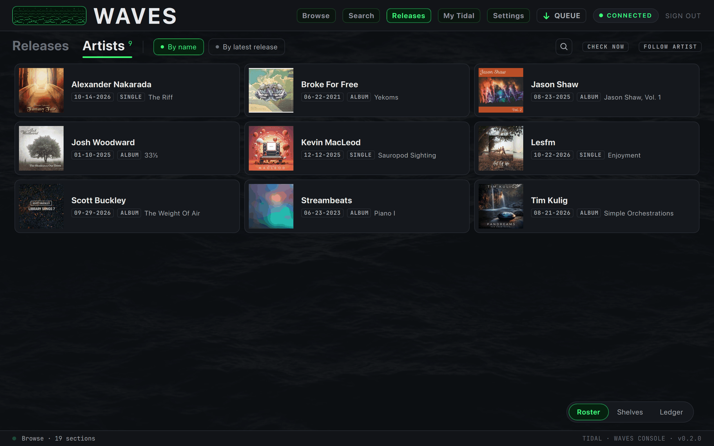<br><sub><strong>Roster</strong>: everyone you follow, with their latest release.</sub></td>
    <td width="50%">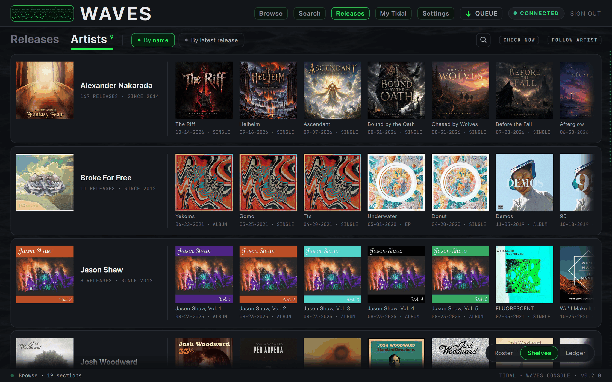<br><sub><strong>Shelves</strong>: each artist's releases in a row, newest first.</sub></td>
  </tr>
  <tr>
    <td colspan="2">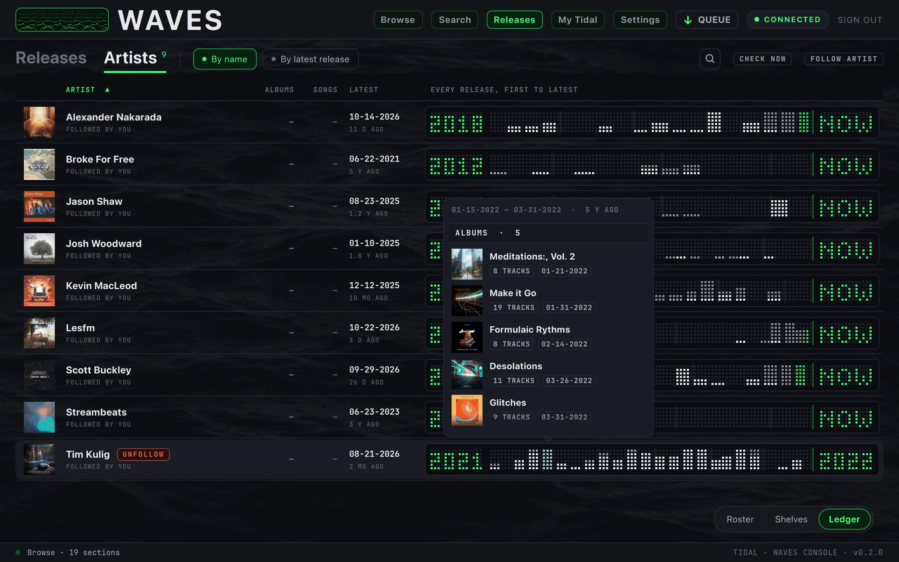<br><sub><strong>Ledger</strong>: every career on one timeline, from the first release to now. Point at a stretch to see what came out then.</sub></td>
  </tr>
</table>

### 🔎 Search first, art forward

One field searches artists, albums, tracks, videos, playlists and mixes, or opens a pasted `tidal.com` link straight away. The paste button pastes what you copied and runs the search in the same click.

- Results are grouped by type, with cover art inline, color-coded quality badges (HI-RES / LOSSLESS / HIGH) and release-date sorting.
- Albums and playlists unfold in place with per-track selection, and clicking a quality badge picks the quality for just that album or song.
- Preview an artist in place, then save a whole discography for offline listening.

<p align="center">
  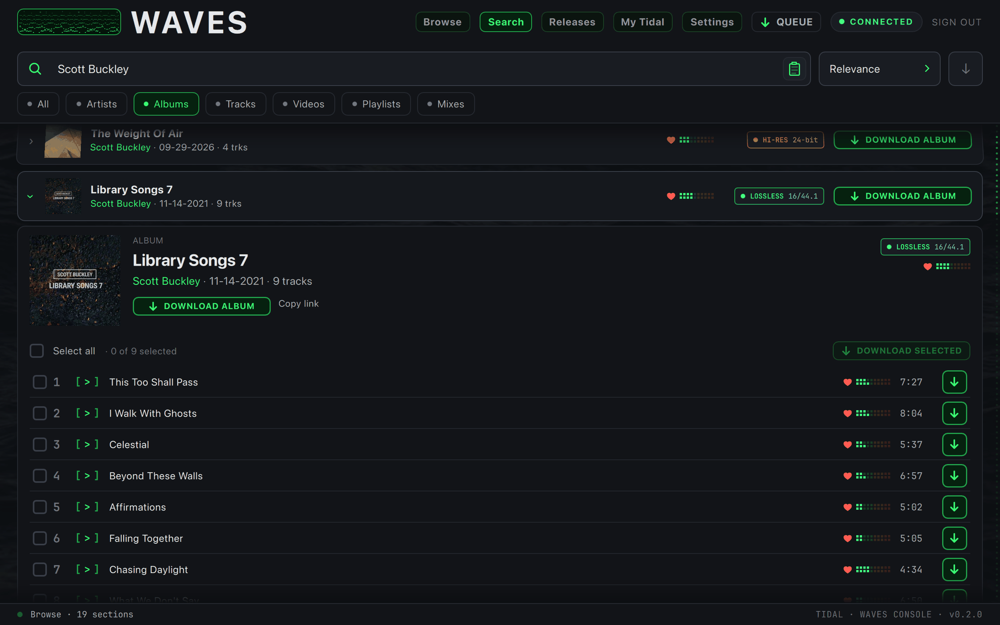
</p>

### 🧭 Browse, and artist pages worth reading

Waves opens on TIDAL's editorial front page (New Arrivals, TIDAL Rising, every genre, mood and decade) and your personalized shelves, art first, with a preview and a one-click save on every cover all the way down. Leave Waves open for days and every page keeps up with what TIDAL shows now.

- Artist pages bring the bio, the discography, EPs & singles and top tracks, with **Follow** right by the name and one click to save the whole thing.
- Reissues sit at the date they first came out, and anything released in the last two weeks wears a NEW mark.

<table>
  <tr>
    <td width="50%">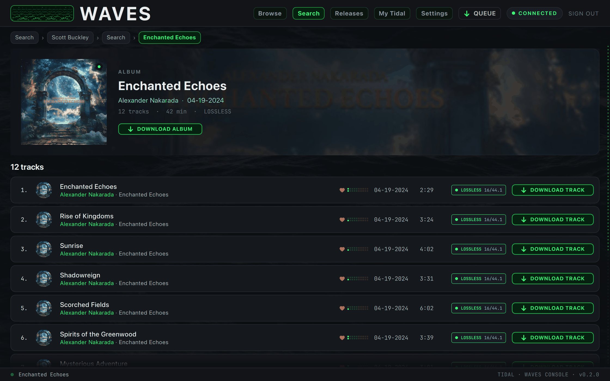<br><sub>Every album opens to its full track list, with a preview and a save button on each track.</sub></td>
    <td width="50%">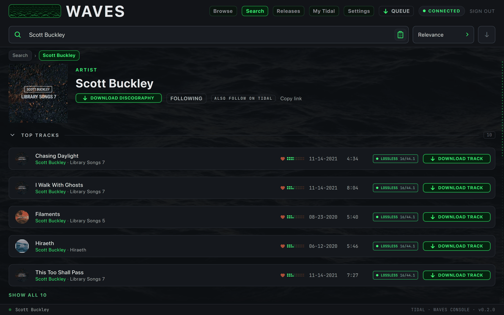<br><sub>The whole discography, with Follow right by the name.</sub></td>
  </tr>
</table>

### 🎧 Listen and watch before you save

- Play any track as a full preview, streamed from your own account, right where you are. Previews start fast, seek from the ring around the cover or the line along the bottom, and a slim now-playing bar follows you across every view.
- Music videos play inside Waves, with a quality picker (up to 1080p) that switches mid-stream. Rest the pointer on a thumbnail and a preview plays in place.
- Save videos one at a time, all of an artist's at once, or alongside a discography, tagged and filed as `Videos/Artist/[Year] Title`.

### 💿 Whole discographies, the best edition of each

- Pick exactly what a discography brings in: albums, EPs & singles, features, compilations and music videos. Features and compilations bring only the tracks the artist is actually on.
- Waves keeps the **most complete edition** of each album and skips the duplicates, while keeping genuinely different releases like remasters and live takes.
- **Best of both**: when one edition has the bonus tracks and another the better quality, Waves builds a single album that takes each song at its best. Matching is strict (ISRC first), so nothing is dropped or swapped. On by default, tunable in Settings.
- When a release comes in both explicit and clean versions, keep whichever you prefer, or both side by side.

### ❤️ My TIDAL, however large it grows

Your favorite albums, tracks, artists, videos, playlists and mixes, sortable and smooth at any size, opening on a **Home** tab of your newest additions. Every category can be saved in one go, playlist folders drill in like a file manager and mirror on disk, and any playlist can save the **full albums** its songs come from.

### 🏷️ Tagged and filed for your player

- A real library layout by default, `Artist/[Year] Album/Disc-Track. Artist - Title`, the structure Plex reads natively. Paths stay customizable, with a live example as you type and a reference of every token.
- Names are fitted to what your system allows, without mangling Japanese, Cyrillic or emoji titles.
- **Primary album artist in tags** (on by default) writes only the primary artist to the album-artist tag, so Plex won't split multi-artist albums. ReplayGain tags are written by default too, so supporting players level volume without touching the audio.
- **Genre from MusicBrainz** (off by default) writes every genre [MusicBrainz](https://musicbrainz.org) lists for the release into the files a download creates, joined by the **Genre separator** (`; ` by default). For a release it does not list yet, **Artist genres for unlisted releases** (on by default) uses the artist's. Files already in your library are never retagged.
- With **Embed lyrics** or **Save lyrics file** on, Waves asks [LRCLIB](https://lrclib.net) first and falls back to TIDAL (turn off **Prefer LRCLIB lyrics** to use TIDAL's alone). Timed lyrics save as `.lrc`, untimed ones as `.txt`.
- Every FLAC is checked against its audio signature once it arrives, and a file that came without one gets it written, so `flac -t` and strict players accept it. The **FLAC signatures** check in Settings → FFmpeg & FLAC does the same for files you already have: Scan (Deep check also decodes the audio), a CSV report, then Fix. The audio is never changed.

### 📚 Knows the library you already have

- Point Waves at your music folder (Settings → Library) and the albums, artists and tracks you already own wear an **IN LIBRARY** mark wherever they appear (on covers, a corner dot that spells it out when you point at it), color-coded by the quality you hold. It reads your tags, so it works on a library Waves didn't create, and bulk saves skip what you have (**Skip what you already have**, on by default). The scan is off by default, incremental, NAS-friendly and read-only.
- Waves remembers what it has saved: buttons read **DOWNLOADED** across sessions, and album, artist and playlist saves fetch only what's missing. A copy it finds that it did not fetch itself is measured for its quality first. Raise the quality setting later and lower-quality copies offer **DOWNLOAD** again, and the better file keeps the tags you gave the old one.
- Waves only ever looks in two places, your download folder and your library folder. Turn **Skip existing** off and every track is saved again, wherever you already have it.
- **At home on a NAS.** Saving straight to an SMB share is a first-class path: finished tracks land in a few large writes, brief hiccups retry on their own, and an unreachable folder gets one clear dialog with Try again instead of a wall of failures. On macOS, a share the system ejected is mounted back automatically.

### 🧾 A queue that tells you the truth

- Completed, Failed, Stopped, Downloading and Queued sections, with live progress and per-album and per-artist roll-ups.
- Everything runs in the order you queued it, and every row shows the quality it asked for next to the quality that actually arrived.
- **RETRY ALL** retries every failure in one click. An open row shows up to 12 tracks before it scrolls (**Tracks shown in an open queue row**, Settings → Appearance), can list just the ones that did not arrive, and its **REPORT** button saves those as a CSV. **MISSING REPORT** does the same for the whole queue.
- Long runs finish: playlists skip what TIDAL has taken down, wait out a slow-down and carry on past one failing song, and an interrupted save never leaves a half-written file behind.

<p align="center">
  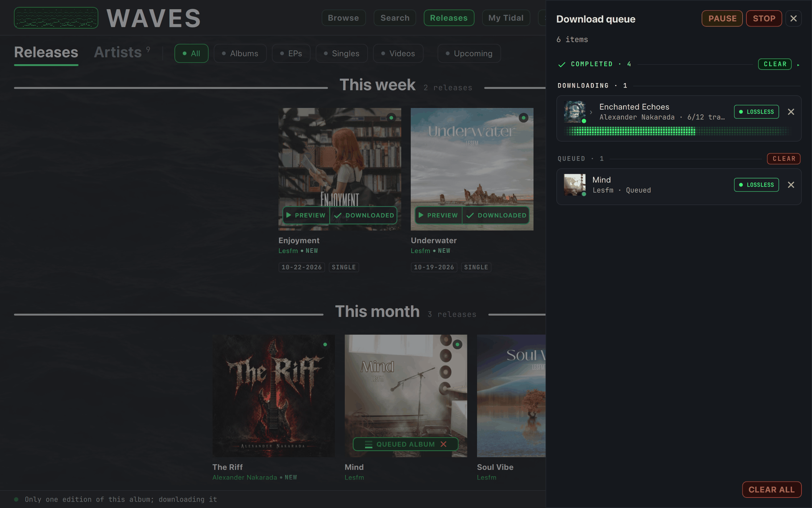
</p>

### ⚙️ Settings, one section at a time

A rail down the side groups every setting into short sections under Music, Files and App, and Settings reopens on the section you left.

- **FFmpeg in one click.** Waves fetches a trusted, checksum-verified FFmpeg build for your OS and CPU, no hunting down binaries or editing paths. A color-coded status light shows where things stand, and anything that would come out degraded without FFmpeg warns you first, with a one-click fix.
- **Desktop notifications.** Off by default; a master switch in Settings → Notifications turns them on and sends a test notification right away, so your system can ask for permission on the spot. Below it you pick what Waves announces: finished downloads (one notification when the queue finishes by default, one per download with downloads that land together grouped, or none), failed downloads, new releases from the artists you follow and new Waves versions the automatic update check finds.
- **A clean way out.** Settings → Diagnostics offers **Reset all settings** (you stay signed in) and **Reset application**, a factory reset of everything Waves saved on this computer. Both ask first, and neither can touch your music: the reset deletes only from a fixed list of Waves' own files.

<p align="center">
  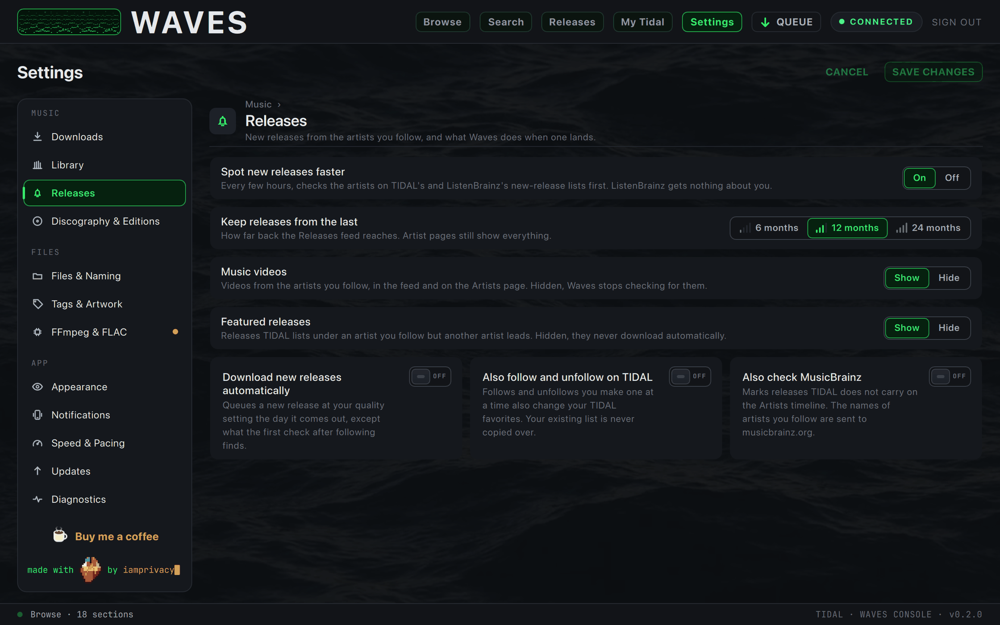
</p>

### 🛡️ Built to be trusted

- Helper binaries are verified before they run: FFmpeg against a published SHA-256, app updates against an Ed25519 signature that fails closed.
- **Built-in updates, opt-in.** Waves can check for a newer version (off by default; once a day or on every launch) and install it from a small in-app notice (fetch, verify, restart). The check only ever notifies you, and it never sends any of your data. Installed with Homebrew, the update runs `brew upgrade` for you instead.
- **Bug reports that keep your privacy.** The optional diagnostic log scrubs identity information the moment each line is written, so an exported report is safe to post publicly. See [Diagnostics](#diagnostics).

### ✨ The little things

- Pages and cover art you've already seen render instantly from a local cache and refresh quietly in the background. Back and Forward land on a finished page with the scroll position and expanded albums intact, tabs reopen where you left them, and a breadcrumb trail jumps back to any step.
- A calm, dark console theme in CRT phosphor green, drawn in Qt Quick.
- A cinematic open-water launch, an ASCII wave logo that weathers the occasional lightning storm, cover art that tilts toward your cursor, a back-to-top pill on every page, and a window that reopens at the size and place you left it.
- On Windows, every FFmpeg job (FLAC extraction, video conversion, previews) runs hidden, so no console window flashes up and steals focus while you type.

---

## Install

**You'll need**

- A **paid TIDAL plan** and a one-time sign-in. Waves walks you through the browser sign-in on first launch and reuses the cached token afterward.
- **macOS 12 Monterey or newer**, on Intel and Apple silicon alike. The regular macOS builds need **macOS 15 Sequoia**; on Monterey through Sonoma, grab the `legacy` build instead (same app, an older bundled Qt). Homebrew and the in-app updater pick the right one for your machine automatically.
- On Linux, **glibc 2.35 or newer** (Ubuntu 22.04, Debian 12, Fedora 36 or anything newer) on x64, and **glibc 2.39 or newer** (Ubuntu 24.04, Debian 13, Fedora 40 or anything newer) on ARM64.
- FFmpeg, for in-app previews and a few conversions (some video and hi-res cases). Waves installs it for you in one click.

**Download** the build for your platform from the [**latest release**](https://github.com/iamprivacy/Waves/releases/latest):

| OS                  | Intel / AMD (x64)              | ARM (Apple silicon, etc.)              |
| ------------------- | ------------------------------ | -------------------------------------- |
| macOS 15+           | `waves_macos-intel.zip`        | `waves_macos-apple-silicon.zip`        |
| macOS 12 through 14 | `waves_macos-intel_legacy.zip` | `waves_macos-apple-silicon_legacy.zip` |
| Windows             | `waves_windows-x64.zip`        | `waves_windows-arm64.zip`              |
| Linux               | `waves_linux-x64.zip`          | `waves_linux-arm64.zip`                |

Unzip and run: on macOS, drag `waves.app` to Applications (the first launch needs a one-time approval, see below); on Windows and Linux, run `Waves` from the unzipped folder. Every asset ships with a SHA-256 checksum and the release carries a signed `SHA256SUMS` manifest; [Verify a download](#verify-a-download) has the copyable steps.

**macOS, with Homebrew**

```bash
brew tap iamprivacy/waves
brew install --cask waves
```

Waves then knows it's Homebrew-managed, and the in-app **Update & restart** button runs `brew upgrade` for you.

**Linux, as an AppImage:** take `waves_linux-x64.AppImage` (or `-arm64`) from the release, mark it executable (`chmod +x`) and run it directly: no unzip, no install step. The in-app updater keeps it current in place.

### First launch

> [!IMPORTANT]
> On macOS, the builds are not yet Apple-notarized, so macOS quarantines a freshly downloaded `waves.app`. On first launch macOS shows a warning with no way to proceed: click **Done**, then go to **System Settings → Privacy & Security**, scroll down, and click **Open Anyway** next to the Waves entry. Confirm once and macOS remembers the choice from then on. (The old right-click → Open shortcut no longer works on macOS 15 Sequoia and later.)

> [!NOTE]
> On Windows, the builds are not yet code-signed, so the first launch may show a Microsoft Defender SmartScreen prompt ("Windows protected your PC"). Click **More info**, then **Run anyway**. SmartScreen is a reputation check on new, unsigned software, not a malware detection, and it fades on its own as a release builds up clean installs.

<details>
<summary><strong>Run from source</strong></summary>
<br>

Needs Python 3.12 or 3.13.

```bash
# from a clone of this repository
python -m venv .venv && source .venv/bin/activate   # Windows: .venv\Scripts\activate
pip install -e ".[gui]"     # the [gui] extra pulls in PySide6 / Qt
python -m waves.waves_ui
```

</details>

---

## Verify a download

Optional, for anyone who wants to check a download before the first launch. Every release carries two small files next to the builds: `SHA256SUMS`, one line per asset with its SHA-256, and `SHA256SUMS.sig`, an Ed25519 signature over that file made with the Waves release key. The release page also prints each asset's hash in its **Verify** section. This is the public half of the release key, compiled into every build and checked by the in-app updater before it installs anything:

```
-----BEGIN PUBLIC KEY-----
MCowBQYDK2VwAyEAcetggrhiqyMN5HsBCi/f2gJL75FVPOYGU/sd4dI5b+0=
-----END PUBLIC KEY-----
```

**macOS or Linux**, from a folder holding the zip, `SHA256SUMS` and `SHA256SUMS.sig`. The signature step needs OpenSSL 3. Most current Linux distributions ship it; on macOS the built-in `openssl` is LibreSSL, which cannot check it, so install OpenSSL 3 with `brew install openssl@3` and run the third command with `$(brew --prefix openssl@3)/bin/openssl` in place of `openssl`:

```bash
printf '%s\n' '-----BEGIN PUBLIC KEY-----' 'MCowBQYDK2VwAyEAcetggrhiqyMN5HsBCi/f2gJL75FVPOYGU/sd4dI5b+0=' '-----END PUBLIC KEY-----' > waves-release.pem
base64 --decode < SHA256SUMS.sig > SHA256SUMS.sig.bin
openssl pkeyutl -verify -pubin -inkey waves-release.pem -rawin -in SHA256SUMS -sigfile SHA256SUMS.sig.bin
grep -v '^#' SHA256SUMS | tr -d '\r' | shasum -a 256 --ignore-missing -c -
```

The third command must print `Signature Verified Successfully` and the last one `<asset>: OK` for the zip you downloaded (on a system without `shasum`, use `sha256sum` in its place). Any other output means the file does not match this release: delete it and download it again.

**Windows** (PowerShell), from the same folder, with `waves_windows-x64.zip` replaced by the zip you downloaded:

```powershell
(Get-FileHash .\waves_windows-x64.zip -Algorithm SHA256).Hash.ToLower()
Select-String -Path SHA256SUMS -Pattern waves_windows-x64.zip
```

The two hashes must be identical. To also check the signature on Windows, run the macOS/Linux commands in Git Bash, which ships OpenSSL.

**Waves is open source, so you can check the code for yourself. If reading code isn't your thing, you can upload the zip to [VirusTotal](https://www.virustotal.com) and have it checked before you even extract it. Your privacy and security are important to me. Trust, but verify.**

---

## Privacy

**Privacy is the foundation of this application.** Waves collects nothing about you and has no way of knowing how the application is used: no telemetry, no analytics, no tracking.

With TIDAL, Waves does what you ask, and while it's open it also keeps the Releases tab current: it follows your TIDAL favorite artists (and, with a library set up, the artists in it, found on TIDAL by name) and checks them for new releases at a gentle pace. Apart from TIDAL, Waves makes one request on its own and the rest only when you turn them on, and **none of them carries your account, your identity or anything about how you use Waves**:

| Service                                  | When Waves asks it                                                           | What it sends                                         | Default |
| ---------------------------------------- | ---------------------------------------------------------------------------- | ----------------------------------------------------- | ------- |
| [ListenBrainz](https://listenbrainz.org) | **Spot new releases faster** (Settings → Releases), every few hours          | Only how many days to look back and ahead             | **On**  |
| [FFmpeg host](#built-with)               | When you click **INSTALL FFMPEG**, and for FFmpeg's automatic update check   | A request for the build                               | **Off** |
| GitHub releases                          | Automatic update checks, to see whether a newer Waves exists                 | Nothing about you                                     | **Off** |
| [LRCLIB](https://lrclib.net)             | **Embed lyrics** or **Save lyrics file**, for each track you save            | The track's artist, title, album and length           | **Off** |
| [MusicBrainz](https://musicbrainz.org)   | **Ask MusicBrainz when unsure** (Settings → Library), during a library scan  | The artist and title of an album the scan can't match | **Off** |
| [MusicBrainz](https://musicbrainz.org)   | **Look up your artists on MusicBrainz** (Settings → Library)                 | Your library's artist names                           | **Off** |
| [MusicBrainz](https://musicbrainz.org)   | **Also check MusicBrainz** (Settings → Releases)                             | The names of the artists you follow                   | **Off** |
| [MusicBrainz](https://musicbrainz.org)   | **Genre from MusicBrainz** (Settings → Tags & Artwork), for each new release | The release's barcode, or its title and artist        | **Off** |

- **ListenBrainz** answers with its public list of new releases, and Waves matches it against your follows on your own machine.
- **FFmpeg's update check** runs on every launch or at most once a day (your choice, once a day by default). The default above is for the check; installing only happens when you click.
- **Waves' update check** only ever notifies you: nothing is downloaded until you choose to update.
- **Lyrics:** turning off **Prefer LRCLIB lyrics** skips LRCLIB and uses TIDAL's lyrics alone.
- **Genre from MusicBrainz:** with **Artist genres for unlisted releases** on (the default), it also sends the artist's name when MusicBrainz does not list the release yet, unless Waves already knows the artist from a library or Releases lookup.
- **MusicBrainz** requests go out at most one per second, and their answers are cached locally.

Your credentials and your saved music stay on your machine, and on macOS and Linux the files Waves keeps for itself (your settings, your sign-in, its caches and logs) live in a folder only your account can open, not every account on the machine. The same principle carries into the optional diagnostic log below: nothing leaves your machine unless you export a report yourself.

---

## Diagnostics

Most apps make a bug report cost you your privacy: either describe the problem badly, or hand over a raw log full of your username, file paths and account details. Waves closes that gap by redacting at the source. Identity information never reaches the log in the first place, so there is nothing to leak, whether you export a report or not.

- **Off by default.** Only warnings and errors are kept until you ask for more. In **Settings → Diagnostics**, turn on **Verbose diagnostics**, reproduce the problem, then click **Export report** for one text file ready to attach to an issue.
- **Redacted at the source, not the export.** Every log handler shares the same filter: your user name and home folder (inside file paths too, in every OS's form), the names of the network shares and drives your music folders sit on, hostnames, IP and MAC addresses, emails, session tokens and your TIDAL account id are replaced with placeholders the instant they would otherwise be written, verbose mode or not. The one exception is a native crash or freeze dump, which the system's fault handler writes straight into `crash.log`; **Export report** redacts that too, so attach the report rather than the raw file.
- **A breadcrumb trail, always on.** Waves keeps the last ~250 activity events in memory at no disk cost. The moment something goes wrong, that trail is written to the log automatically, so even a first-time crash arrives with the events that led up to it.
- **An optional second layer.** "Also hide titles and searches" also hashes what you searched for and any track, album or artist names in the export, for anyone who'd rather not share that either.

The log lives at `waves_dev.log`, next to `crash.log`, in the Waves config folder (`~/Library/Application Support/Waves` on macOS, `%APPDATA%\Waves` on Windows, `~/.config/Waves` on Linux). It's plain text, so read it yourself any time you like. **Export report** doesn't send anything anywhere: it writes a separate, timestamped copy of that redacted data into the same folder, and **Show file** opens it in your file manager so you can attach it or send it yourself, wherever you want.

**Logs are never transmitted off your device, unless you do it yourself.**

---

## FAQ

<details>
<summary><strong>Is there a command-line version?</strong></summary>
<br>

Waves is GUI-first and does not ship a command-line interface. If you prefer the command line, use **[Tidaler](https://github.com/maya-doshi/tidaler)** directly: it's a maintained, CLI-focused build (`tidaler` / `tdn`) of the engine Waves descends from.

</details>

<details>
<summary><strong>Does Waves work with a free TIDAL account?</strong></summary>
<br>

No, a paid TIDAL plan is required. A free or lapsed account can sign in, browse and search, but previews, videos and saving all need a plan that can stream. Waves can only save what your account can play.

</details>

<details>
<summary><strong>Will Waves touch the music I already have?</strong></summary>
<br>

The library scan is read-only: it reads your tags and never changes your files. Waves only ever looks in your download folder and your library folder, and the two resets in Settings → Diagnostics delete only from a fixed list of Waves' own files. The FLAC signatures **Fix** writes to files you already have only when you click it, and only the missing signature in each file's header: the audio is never changed.

A copy in your download folder is replaced only when you ask for it again with **Skip existing** off, click **REDOWNLOAD**, or it sits below your quality setting, and the new file keeps the tags you added (Genre, Comment, Mood and the like). **Genre from MusicBrainz** writes only to new downloads.

</details>

<details>
<summary><strong>Where does Waves keep its settings and logs?</strong></summary>
<br>

In the Waves config folder: `~/Library/Application Support/Waves` on macOS, `%APPDATA%\Waves` on Windows and `~/.config/Waves` on Linux. On macOS and Linux only your account can open it.

</details>

<details>
<summary><strong>Something went wrong. How do I report it?</strong></summary>
<br>

Open an [issue on GitHub](https://github.com/iamprivacy/Waves/issues). If you can, turn on **Verbose diagnostics** in Settings → Diagnostics, reproduce the problem, and attach the file **Export report** writes. It's redacted before it's written, so it's safe to post (see [Diagnostics](#diagnostics)).

</details>

---

## Contributing

Bug reports, ideas and pull requests are all welcome. [CONTRIBUTING.md](CONTRIBUTING.md) explains how to help, and [DEVELOPER.md](DEVELOPER.md) covers the codebase and how to build it.

---

## A note from the author

Waves is the first piece of software I've ever released. I've spent a couple of decades in and out of tech, most of it on the other side of the fence, beta-testing, filing bug reports, and helping developers polish their games and software. Building something and putting my own name on it is new to me, and so is everything that comes after a release: the maintaining, the issue-tracking, the keeping-the-lights-on side of running a project. This is a side project built in spare time, so I won't always be fast, and I'm certain I'll get some things wrong as I learn the developer's half of all this.

None of that changes the welcome. If something breaks, behaves oddly, or just feels off, please open an issue, however small, and I'll genuinely read it and do my best to reply. Giving feedback is the thing I know how to do best, and I'm grateful to now be on the receiving end of it. Thank you for trying Waves.

---

## Star History

<!-- star-history:start -->
<picture>
  <source media="(prefers-color-scheme: dark)" srcset="assets/star-history/star-history-dark.svg">
  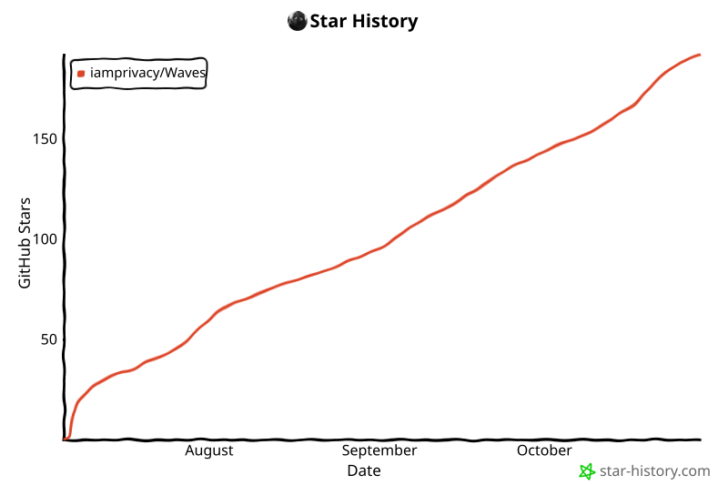
</picture>
<!-- star-history:end -->

---

## Acknowledgments

### Standing on the shoulders of others

Waves exists because of a chain of people who built, and kept alive, a tool a lot of us love. None of this is mine alone.

- **exislow** created Tidal-DL-NG, the project everything here descends from. The original repository and account disappeared from GitHub, and as far as I know exislow never returned. The work was, and is, excellent. Thank you.
- After that, members of the community picked it up and kept it running. Some of those forks were taken down too, or wound down over time. Everyone who spent their own hours keeping it alive has my gratitude.
- Today it lives on as **[Tidaler](https://github.com/maya-doshi/tidaler)**, maintained by **[maya-doshi](https://github.com/maya-doshi/)** in their spare time. Waves began as a front end built directly on Tidaler, and its engine descends from Tidaler's. Thank you, maya-doshi, for keeping the lights on.
- Underneath all of it sits **[tidalapi](https://github.com/tamland/python-tidal)**, the Python TIDAL client the rest of the stack is built on: every search, every sign-in and every track goes through it. Tidal-DL-NG began by wrapping it, and Tidaler and Waves rest on it still. Thank you to everyone who has built and maintained it.

I'm a sucker for a beautiful graphical interface and tend to avoid the command line, but I seem to be in the minority, so the GUI side of tools like Tidaler doesn't get as much attention as the engine underneath. Waves began as my way of giving back in a way that's genuinely useful (and, honestly, of scratching my own itch).

The design rule has been the same from the start: **don't break what works, but never stop improving what can be.** The foundations of the engine still come from Tidal-DL-NG by way of Tidaler: signing in to TIDAL, the multithreaded, segmented transfer core, and the tagging and settings machinery the rest is built on. Nothing was rewritten for its own sake, but wherever that code met a real problem, Waves changed it, and over time that has added up to about three quarters of today's engine being new code. To be just as plain about who wrote what: I wrote the interface, the in-app updater, the managed FFmpeg install, the packaging and signed releases that ship it all as a desktop app, and most of today's engine, which by git blame comes to over nine tenths of the application code in this repository. The rest is the code Tidal-DL-NG built and Tidaler carried forward, and it is still the foundation everything here stands on.

**Waves is, and always will be, open source under the same license as Tidal-DL-NG and Tidaler** (see [License](#license)).

### Built with

Waves is only possible because of a lot of excellent open-source work. All credit to the authors and maintainers.

**Core libraries**

- [tidalapi](https://github.com/tamland/python-tidal): the TIDAL API client at the heart of the engine
- [PySide6 / Qt for Python](https://doc.qt.io/qtforpython/): the toolkit Waves is drawn with
- [mutagen](https://github.com/quodlibet/mutagen): audio tags
- [python-ffmpeg](https://github.com/jonghwanhyeon/python-ffmpeg), [m3u8](https://github.com/globocom/m3u8), [pycryptodome](https://github.com/Legrandin/pycryptodome): streaming, playlist parsing and update signature checks
- [requests](https://github.com/psf/requests), [urllib3](https://github.com/urllib3/urllib3), [certifi](https://github.com/certifi/python-certifi), [dataclasses-json](https://github.com/lidatong/dataclasses-json), [pathvalidate](https://github.com/thombashi/pathvalidate)
- [Nuitka](https://nuitka.net): compiles Waves into the app you download

**FFmpeg**

- [**FFmpeg**](https://ffmpeg.org) © the FFmpeg project, the tool itself.
- The one-click installer downloads (never redistributes) prebuilt static binaries from:
  - **macOS & Linux** (all architectures): [**ffmpeg.martin-riedl.de**](https://ffmpeg.martin-riedl.de) ([build scripts](https://git.martin-riedl.de/ffmpeg/build-script)), native per-architecture builds; the macOS builds are signed and notarized. Thank you, Martin Riedl.
  - **Windows**: [**BtbN/FFmpeg-Builds**](https://github.com/BtbN/FFmpeg-Builds). Thank you, BtbN.

**Lyrics**

- [**LRCLIB**](https://lrclib.net): the open, community-driven synced-lyrics database Waves asks first, run free of charge, with no key and no strings attached. Thanks to everyone who contributes lyrics to it.
- [**LRCGet**](https://github.com/tranxuanthang/lrcget) by [**tranxuanthang**](https://github.com/tranxuanthang), who built both LRCGet and LRCLIB itself and keeps the service running for everyone. Waves' lyrics support follows the path LRCGet paved. Thank you.

**Music data**

- [**MusicBrainz**](https://musicbrainz.org) and [**ListenBrainz**](https://listenbrainz.org), run by the nonprofit MetaBrainz Foundation: the open music encyclopedia behind the optional library and Releases checks, and the public list of fresh releases that helps Waves spot new releases sooner. Thanks to everyone who edits and maintains them.

**Type and icons**

- [JetBrains Mono](https://www.jetbrains.com/lp/mono/) is bundled for the interface, under the [SIL Open Font License](waves/waves_ui/fonts/OFL.txt).
- [Phosphor Icons](https://phosphoricons.com): the interface glyphs (play, pause, download, search and the rest) are bundled from Phosphor, under the [MIT License](waves/waves_ui/qml/PHOSPHOR-LICENSE.txt).

If I've missed anyone, it's an oversight, not an intent. Please open an issue and I'll fix the credit.

---

## License

Waves is licensed under the **GNU Affero General Public License v3.0 (AGPL-3.0)**, the same license as Tidal-DL-NG and Tidaler. See [LICENSE](LICENSE) for the full text. Because Waves is a derivative work, it stays AGPL-3.0, and so must anything built on it.

Copyright (C) 2026 iamprivacy. Waves is free software: you can redistribute it and/or modify it under the terms of the AGPL-3.0.

---

## Disclaimer

Waves is an independent project and is **not affiliated with, endorsed by, or sponsored by TIDAL**. TIDAL is a trademark of its owner, used here only to identify the service Waves works with.

Waves is a personal, non-commercial tool for **your own** TIDAL account, using your own credentials. It can only save what your account can already play: it cannot reach anything the account cannot reach, it does not remove or bypass any encryption or copy protection, and it is not a way around a subscription. If TIDAL will not serve a stream to your account, Waves cannot save it.

You are solely responsible for how you use it. Do not use it to infringe copyright or to reproduce, distribute, or pirate content. **Your use may violate TIDAL's Terms of Service, and you accept that risk**, including any consequences to your account.

The software is provided "as is", without warranty of any kind, and to the fullest extent permitted by law its developers and contributors accept no liability for any damages arising from it. See sections 15 and 16 of the [AGPL-3.0](LICENSE). By using Waves you agree to indemnify and hold harmless its developers and contributors against any claim arising from your use of it or your breach of these terms.

Waves collects no information and its developer has **no way of knowing how the application is used**. That is a deliberate privacy design, not an excuse: anyone using Waves to infringe copyright does so in breach of these terms and without the developer's knowledge or consent.

Full terms: **<https://getwaves.dev/terms/>**. Questions reach the project through [GitHub issues](https://github.com/iamprivacy/Waves/issues).

Please respect the artists and rights-holders whose work this plays.
